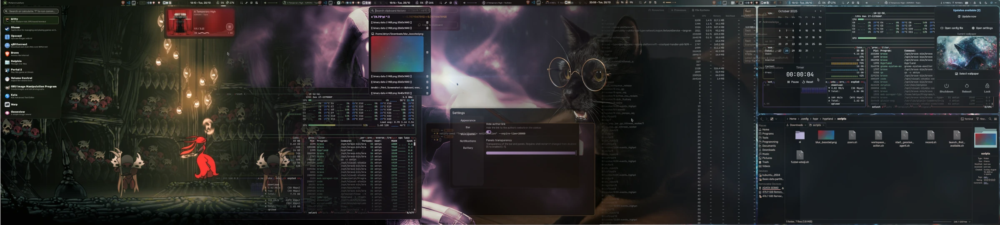
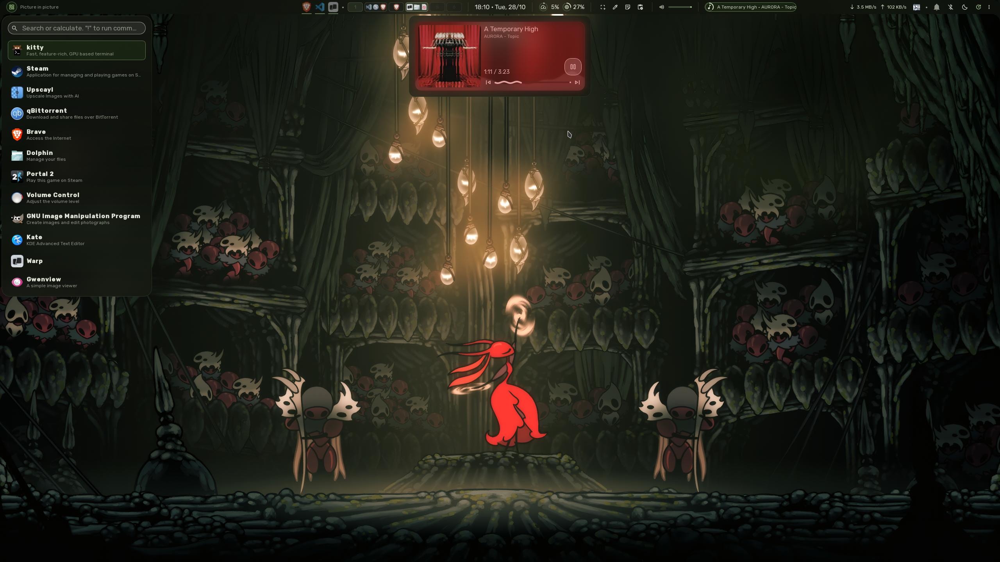
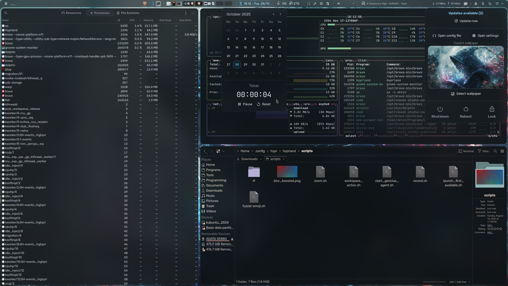
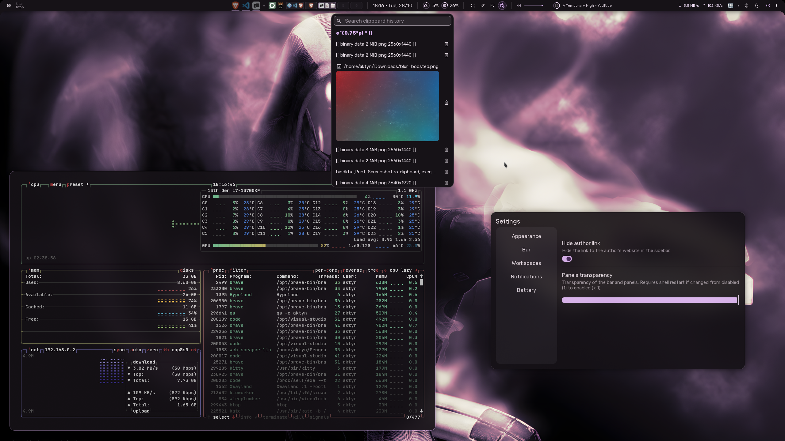
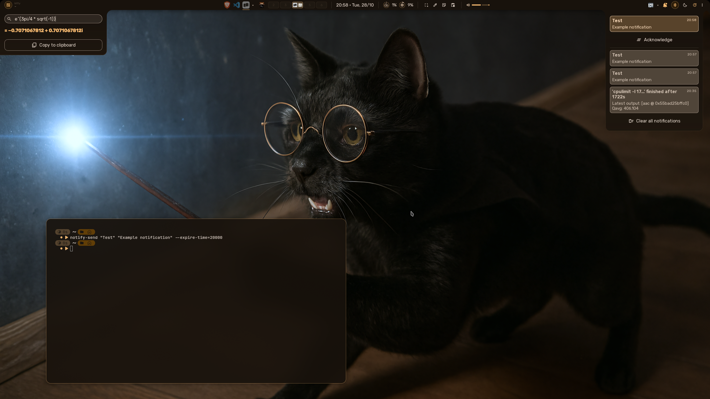

# Configuración personalizada de [Hyprland](https://hypr.land/) con shell personalizado

Una configuración completa y rica en funciones de Hyprland con integración de Quickshell, un tema SDDM personalizado y aplicaciones cuidadosamente seleccionadas para una experiencia de escritorio óptima.  
Este proyecto está diseñado para uso personal, aunque estaré encantado de implementar funciones adicionales bajo solicitud.  
Está diseñado para ser práctico y eficiente durante el uso diario y el trabajo.  
La configuración no favorece a los usuarios orientados al mouse ni al teclado; todo se puede hacer "con una mano", según la preferencia de cada uno.

La configuración de Hyprland está escrita en Lua. [Ver por qué es importante](https://hypr.land/news/26_lua)

[Abrir un issue para solicitar funciones](https://github.com/Aktyn/hyprland-setup/issues/new)

[](https://ko-fi.com/U6J222F0OJ)



## 🚀 Instalación

El script `install.sh` instala automáticamente todos los paquetes requeridos, las aplicaciones sugeridas y configura una instalación personalizada de Hyprland con Quickshell, rico en funciones.

**⚠️ Importante:** Este script sobrescribirá tu configuración existente de Hyprland, excepto el archivo **custom.lua**. Por favor, haz una copia de seguridad de tu configuración actual antes de continuar.  
Después de la instalación, debes colocar toda tu configuración personalizada de Hyprland dentro del archivo `~/.config/hypr/custom.lua`.  
[Archivo de ejemplo **custom.lua**](https://gist.github.com/Aktyn/4d5c047da59c43f5d10747a4f0ada5b8) (úsalolo solo como referencia, ya que no funcionará con una configuración de monitor diferente)

### Requisitos previos

- **Linux** con uno de los siguientes administradores de paquetes: ***pacman***, ***apt***, ***dnf***, ***zypper***
- **Hyprland** debe estar ya instalado en tu sistema
- **Acceso sudo** para la instalación de paquetes
- **Mínimo 20% de batería** (en portátiles)

### Métodos de instalación

#### Método 1: Clonar y ejecutar (Recomendado)

```sh
git clone https://github.com/Aktyn/hyprland-setup.git
cd hyprland-setup
./install.sh
```

#### Método 2: Instalación en una sola línea

Ejecutar directamente con wget:

```sh
wget -qO - https://raw.githubusercontent.com/Aktyn/hyprland-setup/main/install.sh | bash
```

O con curl:

```sh
curl -Ls https://raw.githubusercontent.com/Aktyn/hyprland-setup/main/install.sh | bash
```

## 📦 Paquetes y aplicaciones instalados

### Herramientas y utilidades del sistema

- **git** - Sistema de control de versiones
- **python** - Lenguaje de programación Python
- **base-devel** - Herramientas de desarrollo (make, gcc, etc.)
- **yay** - Ayudante del AUR (se instala automáticamente si falta)
- **python-pillow** - Fork de la Python Imaging Library
- **python-materialyoucolor-git** (AUR) - Biblioteca de Python para generar esquemas de color Material You

### Editores de texto y terminales

- **kate** - Editor de texto avanzado con resaltado de sintaxis
- **warp-terminal-bin** (AUR) - Emulador de terminal moderno
- **kitty** - Terminal predeterminada para tareas rápidas
- **fish** - Shell predeterminado

### Monitoreo y gestión del sistema

- **gnome-system-monitor** - Monitor de recursos del sistema
- **btop** - Monitor de recursos que muestra el uso y estadísticas
- **blueman** - Interfaz gráfica para la gestión de Bluetooth
- **pavucontrol** - Interfaz gráfica de control de volumen
- **cava** - Visualizador de audio
- **plasma-nm** - Applet del administrador de red de KDE
- **plasma-activities** - Servicio de actividades de KDE
- **systemsettings** - Configuración del sistema de KDE
- **nwg-look** - Editor de configuración GTK3 para compositor wlroots

### Portapapeles y utilidades

- **xclip** - Interfaz de portapapeles de línea de comandos
- **cliphist** - Administrador del historial del portapapeles
- **wl-clipboard** - Utilidades de copia/pegado de línea de comandos para Wayland
- **gnome-keyring** - Daemon de GNOME Keyring para almacenar información sensible de forma segura
- **polkit-kde-agent** - Agente de autenticación de PolicyKit que gestiona los prompts de elevación de privilegios
- **kdialog** - Cuadros de diálogo de KDE para scripts
- **Dolphin** - Administrador de archivos de KDE
- **grim**, **slurp**, **tesseract** - Paquetes requeridos para las funciones de OCR
- **playerctl** (AUR) - Utilidad de línea de comandos para controlar reproductores multimedia
- **libdbusmenu-gtk3** (AUR) - Biblioteca para pasar estructuras de menú a través de DBus

### Temas y fuentes

- **gnome-themes-extra** - Temas GTK adicionales
- **ttf-material-icons** (AUR) - Iconos de Material Design
- **ttf-material-symbols-variable** (AUR) - Fuente de símbolos Material variables
- **ttf-jetbrains-mono-nerd** (AUR) - Fuente JetBrains Mono Nerd
- **ttf-readex-pro** (AUR) - Fuente Readex Pro
- **ttf-rubik-vf** (AUR) - Fuente Rubik

### Visualización y procesamiento de imágenes

- **gwenview** - Visor de imágenes
- **imagemagick** (AUR) - Herramientas de manipulación de imágenes

### Dependencias del marco Qt

- **qt5-wayland** & **qt6-wayland** - Soporte para Wayland
- **qt5-multimedia** & **qt6-multimedia** - Soporte multimedia
- **qt5-imageformats** & **qt6-imageformats** - Formatos de imagen adicionales
- **qt5-svg** & **qt6-svg** - Soporte SVG
- **qt5-declarative** - Soporte QML
- **qt5-graphicaleffects** - Efectos visuales

### Ecosistema Hyprland

- **hyprsunset** - Filtro de luz azul
- **hypridle** - Daemon de gestión de inactividad de Hyprland
- **hyprlock** - Bloqueo de pantalla para Hyprland
- **hyprpicker** - Selector de color
- **hyprshot** - Utilidad de capturas de pantalla
- **quickshell** (AUR) - Shell de escritorio personalizable

### Gestor de pantalla

- **SDDM** con tema personalizado (configurado automáticamente)

## 🔄 Actualizaciones

Para actualizar a la última versión, simplemente ejecuta el script de instalación nuevamente. Actualizará automáticamente tu configuración de Hyprland y Quickshell conservando tus personalizaciones.

## 📸 Vistas previas

Aquí tienes una muestra de la configuración personalizada de Hyprland con integración de Quickshell:






## 🎯 Características

- **Configuración personalizada de Hyprland** - Ajustes optimizados para productividad y estética
- **Integración de Quickshell** - Entorno de escritorio rico en funciones con widgets, paneles y utilidades
- **Tema SDDM personalizado** - Pantalla de inicio de sesión elegante que coincide con el tema del escritorio
- **Iconos Material Design** - Conjunto de iconos modernos para una experiencia visual coherente
- **Gestión del portapapeles** - Historial y gestión avanzada del portapapeles
- **Monitoreo del sistema** - Monitoreo de recursos e información del sistema integrado
- **Visualización de audio** - Visualizador de audio en tiempo real con Cava
- **Soporte Bluetooth** - Gestión fácil de dispositivos Bluetooth
- **¡Y mucho más!** - Explora el conjunto completo de características después de la instalación
