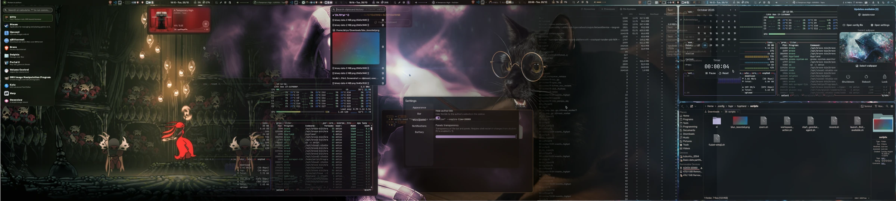
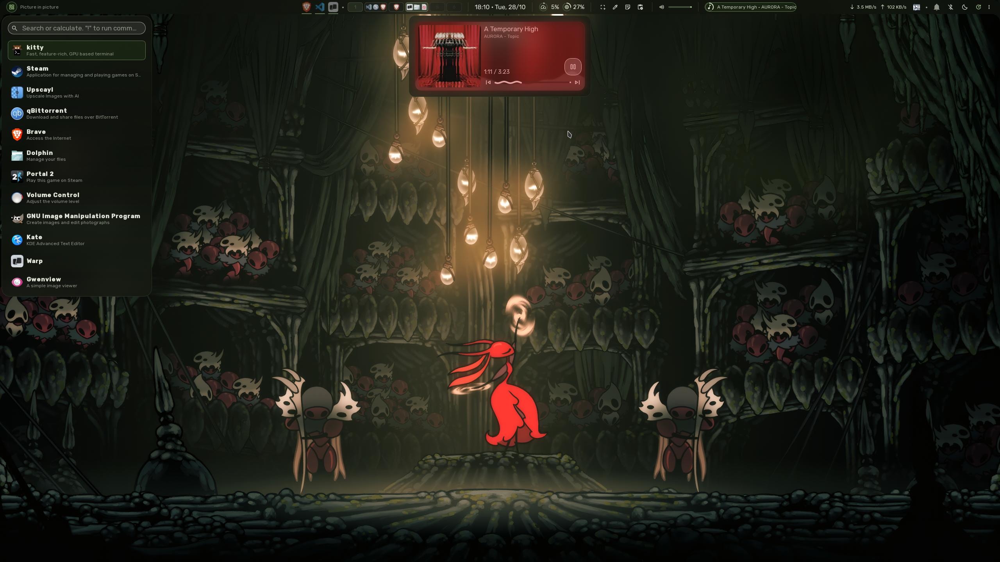
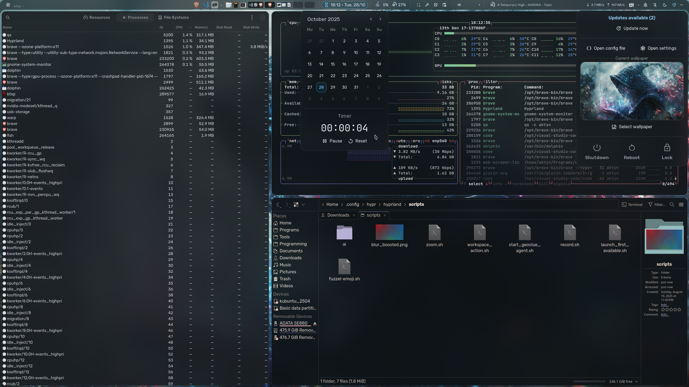
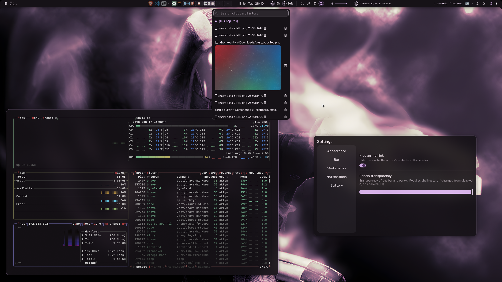
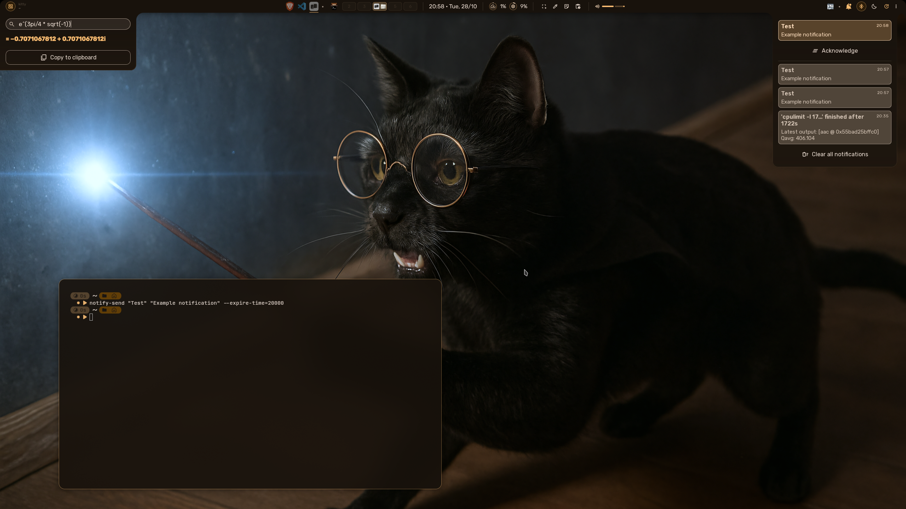

# Personalized [Hyprland](https://hypr.land/) Setup with a custom GPUI shell written in rust

A comprehensive Hyprland configuration with a custom Rust/GPUI shell, custom SDDM theme, and carefully selected applications for an optimal desktop experience.
This project is made for personal use although I'm happy to implement additional features upon request.  
It is designed to be practical and efficient during daily usage and work.  
The configuration does not favour either mouse- or keyboard-oriented users — everything can be done 'one-handed', depending on one's preference.

Hyprland configuration is written in lua. [See why it matters](https://hypr.land/news/26_lua)

[Open an issue to request features](https://github.com/Aktyn/hyprland-setup/issues/new)

[](https://ko-fi.com/U6J222F0OJ)



## 🚀 Installation

The `install.sh` script installs the required packages and Rust toolchain, builds the GPUI shell, and sets up the customized Hyprland configuration. The shell binary is installed to `~/.local/bin/aktyn-shell`.

The GPUI port provides status bars on connected displays, workspaces, a searchable application launcher, navigable calendar and configurable timer, clipboard history, notes, notifications, system/audio panels, session actions, and a keyboard shortcut sheet. Its settings include live appearance/bar/workspace controls and configurable battery warnings and suspend behavior. It renders a selectable wallpaper, hosts StatusNotifier items with pixmap icons and custom DBusMenu popups, and provides a shell-owned notification server with history, expiry, actions, dismissal, and temporary toast overlays. The original `quickshell/` QML files remain in the repository as a reference. This is an ongoing port rather than complete feature parity: wallpaper color integration, some specialized OSDs, and full visual parity are still in progress.

**⚠️ Important:** This script will override your existing Hyprland configuration except **custom.lua** file. Please backup your current setup before proceeding.  
After installation you should place all your customised Hyprland configuration inside `~/.config/hypr/custom.lua` file.  
[Example **custom.lua** file](https://gist.github.com/Aktyn/4d5c047da59c43f5d10747a4f0ada5b8) (use it only as a reference, as it won't work with a different monitor configuration)

### Prerequisites

- **Linux** with one of the package managers: ***pacman***, ***apt***, ***dnf***, ***zypper***
- **Hyprland** should already be installed on your system
- **Sudo access** for package installation
- **Minimum 20% battery level** (on laptops)

### Installation Methods

#### Method 1: Clone and Run (Recommended)

```sh
git clone https://github.com/Aktyn/hyprland-setup.git
cd hyprland-setup
./install.sh
```

#### Method 2: One-liner Installation

Run directly with wget:

```sh
wget -qO - https://raw.githubusercontent.com/Aktyn/hyprland-setup/main/install.sh | bash
```

Or with curl:

```sh
curl -Ls https://raw.githubusercontent.com/Aktyn/hyprland-setup/main/install.sh | bash
```

## 📦 Installed Packages and Applications

### System Tools & Utilities

- **git** - Version control system
- **python** - Python programming language
- **base-devel** - Development tools (make, gcc, etc.)
- **yay** - AUR helper (automatically installed if missing)
- **python-pillow** - Python Imaging Library fork
- **python-materialyoucolor-git** (AUR) - Python library for generating Material You color schemes

### Text Editors & Terminals

- **kate** - Advanced text editor with syntax highlighting
- **warp-terminal-bin** (AUR) - Modern terminal emulator
- **kitty** - Default terminal for quick tasks
- **fish** - Default shell

### System Monitoring & Management

- **gnome-system-monitor** - System resource monitor
- **btop** - Resource monitor that shows usage and stats
- **blueman** - Bluetooth management GUI
- **pavucontrol** - Volume control GUI
- **cava** - Audio visualizer
- **plasma-nm** - KDE's network manager applet
- **plasma-activities** - KDE activities service
- **systemsettings** - KDE system settings
- **nwg-look** - GTK3 settings editor for wlroots compositors

### Clipboard & Utilities

- **xclip** - Command-line clipboard interface
- **cliphist** - Clipboard history manager
- **wl-clipboard** - Command-line copy/paste utilities for Wayland
- **gnome-keyring** - GNOME Keyring daemon for securely storing sensitive information
- **polkit-kde-agent** - PolicyKit authentication agent that handles privilege elevation prompts
- **kdialog** - KDE dialog boxes for scripts
- **Dolphin** - KDE's file manager
- **grim**, **slurp**, **tesseract** - Packages required for OCR features
- **playerctl** (AUR) - Command-line utility to control media players
- **libdbusmenu-gtk3** (AUR) - Library for passing menu structures over DBus

### Theming & Fonts

- **gnome-themes-extra** - Extra GTK themes
- **ttf-material-icons** (AUR) - Material Design icons
- **ttf-material-symbols-variable** (AUR) - Variable Material symbols font
- **ttf-jetbrains-mono-nerd** (AUR) - JetBrains Mono Nerd Font
- **ttf-readex-pro** (AUR) - Readex Pro font
- **ttf-rubik-vf** (AUR) - Rubik font

### Image Viewing & Processing

- **gwenview** - Image viewer
- **imagemagick** (AUR) - Image manipulation tools

### GPUI Shell Build Dependencies

- **Rust 1.95.0** - Installed through rustup and pinned by the shell project
- **clang**, **cmake**, **pkg-config** - Native build tooling used by GPUI
- **Wayland**, **XKB**, **fontconfig**, **freetype**, and **Vulkan** development libraries

### Hyprland Ecosystem

- **hyprsunset** - Blue light filter
- **hypridle** - Hyprland’s idle management daemon
- **hyprlock** - Screen lock for Hyprland
- **hyprpicker** - Color picker
- **hyprshot** - Screenshot utility
- **aktyn-shell** - This repository's custom shell, built from Rust/GPUI during installation

### Display Manager

- **SDDM** with custom theme (automatically configured)

## 🔄 Updates

To update to the newest version, run the installation script again. It rebuilds and replaces `aktyn-shell` and refreshes the Hyprland setup while preserving your customizations.

## 📸 Previews

These screenshots show the original Quickshell design that the GPUI shell is being ported from:






The GPUI bar and overview panel can be rendered to images offscreen for visual checks without opening desktop windows:

```sh
AKTYN_CAPTURE_BAR=/tmp/aktyn-shell-bar.png AKTYN_CAPTURE_PANEL=/tmp/aktyn-shell-panel.png cargo +1.95.0 test --manifest-path gpui-shell/Cargo.toml capture_shell_components_offscreen_when_requested -- --nocapture
```

## 🎯 Features

- **Custom Hyprland Configuration** - Optimized settings for productivity and aesthetics
- **Rust/GPUI Shell** - Wayland status bar, workspace switcher, searchable app launcher, calendar/time tools, clipboard history, notes, system/audio controls, notifications view, and session actions
- **Custom SDDM Theme** - Beautiful login screen matching the desktop theme
- **Material Design Icons** - Modern icon set for consistent visual experience
- **Clipboard Management** - Advanced clipboard history and management
- **System Monitoring** - Built-in resource monitoring and system information
- **Audio Visualization** - Real-time audio visualizer with Cava
- **Bluetooth Support** - Easy Bluetooth device management
- **And much more!** - Explore the full feature set after installation
